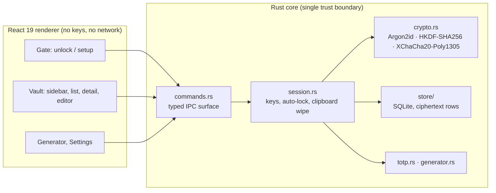
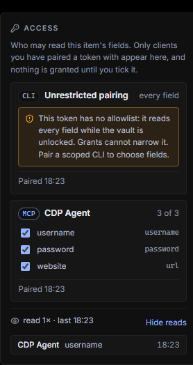
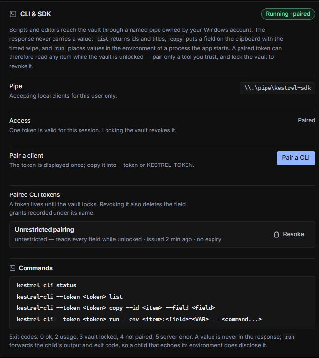
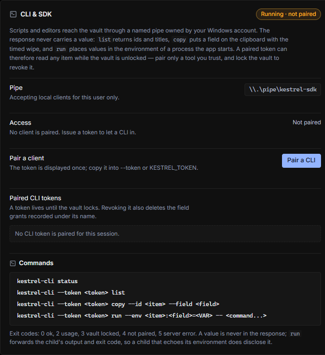

# Kestrel

A local-first password manager: Tauri 2 shell, React 19 UI, Rust core that owns
every key and every byte of ciphertext.

It is a complete desktop password manager — multiple vaults, item history,
attachments, TOTP, a browser bridge, an SSH agent, autofill, a CLI — with its
own design language. All of it is original code under
the MIT licence (`LICENSE`), written against public standards: Argon2id
(RFC 9106), HKDF-SHA256 (RFC 5869), XChaCha20-Poly1305, TOTP (RFC 6238), and the
published 1PUX archive format for import and export. Kestrel is not affiliated
with 1Password; see `NOTICE`.

## Architecture



The properties that matter, and what Kestrel does with each:

| Layer | What it does |
|---|---|
| Renderer | WebView2, CSP `default-src 'self'`, no Node, no network calls from `src/` |
| IPC | one typed `invoke` surface (`commands.rs`, `commands_*.rs`), no free-form channel |
| Core | `crypto.rs` and `store/` own every key and every ciphertext; keys are never serialized outward |
| Storage | SQLite where each row carries an opaque `data BLOB` keyed by UUID; the schema itself holds no secret |
| Cryptography | Argon2id (64 MiB, t=3) for the master key, HKDF-SHA256 per vault, XChaCha20-Poly1305 with bound AAD per object |
| Session | auto-lock watchdog in Rust with an absolute deadline, timed clipboard wipe, keyboard-first UI |
| Items | 18 categories over one generic field model, so a new category needs no new table |

## Security model

- Master password → Argon2id → 32-byte master key → per-vault HKDF subkey.
- Every object is sealed with XChaCha20-Poly1305 and bound to
  `account|vault|item|version` as AAD, so a row cannot be swapped or replayed.
- `verifier` is a sealed constant: unlocking proves the password without storing
  a hash of it.
- Keys live in `SymKey`, zeroized on drop. Locking drops the session; nothing is
  written back in clear text. Item UUIDs stay in the clear on purpose (indexing),
  values never do.
- Changing the master password re-encrypts every item under a new salt.

Private vulnerability reports and the known limitations: [`SECURITY.md`](SECURITY.md).

## Design

The interface is its own system: **Graphite** — neutral white/slate grounds by
day, graphite by night, hairline structure, and one accent the user chooses from
six presets (blue, teal, green, amber, rose, violet), each defined for both
themes and measured for contrast. Accent is a system colour, never a semantic
one: errors, success and warnings keep their own tokens. Inter (400/500/600,
vendored locally) carries all text; Cascadia Mono is reserved for secrets,
codes and numerals.

- Full direction, token values (light + dark + every accent), measured contrast,
  component states, focus contract, motion, keyboard map, per-screen specs and
  design-only specs for every roadmap capability: [`DESIGN.md`](DESIGN.md).
- Evidence (real captures of the running app): [`docs/screenshots/`](docs/screenshots/).
- Shipped UI covers create/unlock/lock, the 18-category vault with search,
  favorites, tags, TOTP, copy-with-wipe feedback, the editor, generator,
  settings (theme + accent, auto-lock, master-password rotation) and a
  real-action command palette. Keyboard-complete, virtualises long lists, and
  stays inside the 500 kB gzip budget.

| Access grants | CLI pairing tokens | After a revoke |
|---|---|---|
|  |  |  |

These are captures of the running Windows build, not mockups: who may read a
field, what a paired process was granted, and what a withdrawn token looks like.

## Layout

```
src/                      React UI
  styles/tokens.css       design tokens (colour, type, space, motion)
  styles/app.css          one stylesheet, no runtime style computation
  ui/                     buttons, fields, overlays, toasts, tooltips
  vault/                  sidebar, list, detail, editor, generator, settings, palette
docs/screenshots/         captures of the running Windows build
DESIGN.md                 direction, tokens, states, keyboard map, specs for
                          capabilities 1–31 and the extension API (§11)
ROADMAP.md                shipped / designed status per capability
SECURITY.md               private disclosure, scope, known limitations
LICENSE                   MIT
NOTICE                    trademark and third-party notes
src-tauri/
  src/lib.rs              Tauri builder, auto-lock watchdog
  src/commands.rs         core IPC surface (typed commands)
  core/                   kestrel-core: zero UI dependencies
    src/crypto.rs         Argon2id · HKDF · XChaCha20-Poly1305 (+ tests)
    src/store/            SQLite schema, ciphertext rows, key rotation,
                          paged queries + the non-secret search projection
    src/session.rs        unlock / auto-lock / clipboard / TOTP glue
    src/model.rs          item model, 18 categories
    src/totp.rs           RFC 6238
    src/generator.rs      password + passphrase generation
    tests/vault.rs        18 end-to-end vault tests
tools/rust-env.ps1        clean PATH wrapper for cargo (harness shell mangles PATH)
tools/smoke.ps1           build → launch → screenshot
```

The core is a separate crate so vault logic can be tested, and later reused by a
CLI or browser bridge, without pulling in a GUI toolkit.

## Requirements

The desktop app is **Windows only**: the shell binds Win32 directly for
autofill (UI Automation), Windows Hello (CNG/NCrypt), the native-messaging
registry keys and named pipes. There is no macOS or Linux build.

- Windows 10 or 11, with the WebView2 runtime (present on Windows 11; install
  the Evergreen bootstrapper on Windows 10).
- Node 22 and npm.
- Rust 1.90 or newer with the `stable-x86_64-pc-windows-gnu` toolchain and a
  GNU linker — WinLibs `mingw64\bin` on `PATH`. The MSVC target is not supported;
  `src-tauri/.cargo/config.toml` pins the static CRT the GNU build needs.
- No other system dependency: no service, no database server, no .NET runtime.

`kestrel-core`, `kestrel-net`, `kestrel-engine` and `kestrel-sync` are plain
Rust and build on Linux; CI runs the core's format, clippy and test jobs on
Ubuntu. The desktop shell itself is only built on Windows.

## Run

```powershell
npm install
npm run app:dev      # tauri dev
npm run app:build    # installer + release binary
```

`npm run app:build` produces an unsigned installer: Windows SmartScreen warns
on first run until someone signs it. Nothing is downloaded at build time except
the npm and crates.io dependencies.

Self-hosted sync — one binary, one SQLite file, one blob directory:

```powershell
cd src-tauri
cargo run -p kestrel-sync            # 127.0.0.1:8787
```

The wire contract is `PROTOCOL.md` and it is **frozen at eight endpoints for
v1**, including `DELETE /v1/devices/<id>`; that route withdraws a device's
access but does not rotate the account key. `deploy/` has the Dockerfile and the
compose file; the image has been built and run once with Podman (see
`deploy/README.md`), the compose path has not.

**What syncs:** all items, notes, TOTP secrets and keys. **What does not yet:**
binary attachments are stored locally only and are not synced. The app says so
on each attachment instead of leaving you to discover it on the other device.

Rust tests:

```powershell
powershell -File tools/rust-env.ps1 cargo test -p kestrel-core --manifest-path src-tauri/Cargo.toml
powershell -File tools/test-shell.ps1        # the shell crate; see the script for why it needs a wrapper
```

Closing the window hides the app to the notification area instead of ending the
process: the session and the global hotkey keep working, and the tray menu has
Open, Lock and Quit. Launching it again restores the hidden window.

Windows toolchain notes: Rust `stable-x86_64-pc-windows-gnu` + WinLibs. Two
adjustments are committed and required — `crate-type = ["rlib"]` (a `cdylib`
would export every symbol; PE caps exports at 65535) and
`-C target-feature=+crt-static` in `src-tauri/.cargo/config.toml` (otherwise the
binaries need the mingw runtime DLLs on `PATH`).

CI (`.github/workflows/ci.yml`) runs `tsc`, the frontend tests and the Vite
build, plus `cargo fmt --check`, `cargo clippy -D warnings` and the core's tests
on Ubuntu. It does not build the Windows shell — that step needs this machine's
toolchain and a Windows runner.

## Status

| Area | State |
|---|---|
| Vault create / unlock / lock / change password | done |
| Item CRUD across 18 categories, custom fields | done |
| Search (never matches secret values), favorites, tags | done |
| TOTP (RFC 6238, `otpauth://` URIs) with live countdown | done |
| Password + passphrase generator with entropy estimate | done |
| Auto-lock watchdog (Rust-side), clipboard auto-wipe | done |
| Encrypted SQLite, WAL, replay-resistant AAD | done |
| Item history, attachments, trash | done |
| Import/export (JSON, CSV, 1PUX), password-gated | done |
| Security audit (weak, reused, HIBP range from the core) | done |
| Quick-access palette window (`Ctrl+Shift+Space`, or `Ctrl+Shift+K` in-app) | done |
| Multiple vaults (separate keys, one password, toolbar switcher) | done |
| Autofill into Windows apps (UI Automation, per-app rules) | done |
| MCP server for environment secrets (`kestrel-mcp.exe`, grants + audit) | done |
| CLI + SDK over a named pipe (`kestrel-cli`, per-session token) | done |
| SSH agent + git signing | done |
| Windows Hello unlock (TPM-backed CNG key) | done |
| Browser extension / autofill bridge (native messaging pipe) | done (`extension/`, MV3) |
| Passkeys / WebAuthn provider | done, one step unproven — Windows does not route passkeys here (`DESIGN.md` §6, item 21) |
| **Phase 3 overall** | **done** — 19–25 shipped |
| **Phase 4**: accounts, sync, sharing, admin | **sync done for items** — `kestrel-sync` (`PROTOCOL.md`, frozen for v1), `kestrel-engine` (per-field merge, conflict review), automatic sync, device enrolment. Sharing, admin/audit and binary attachment transfer are designed in `DESIGN.md` §6 and not built |
| Extension API | **designed, not built** — `DESIGN.md` §11 |
| UI design system and capability specs 1–31 | 1–25 implemented, 26–31 designed |

## Licence

MIT — see [`LICENSE`](LICENSE); the trademark and third-party notes are in
[`NOTICE`](NOTICE). The local app is free and needs no account: it does what it
does today, forever. Hosted sync, sharing and administration are planned but not
built, and no price has been set — this repository is the software, not an offer.
